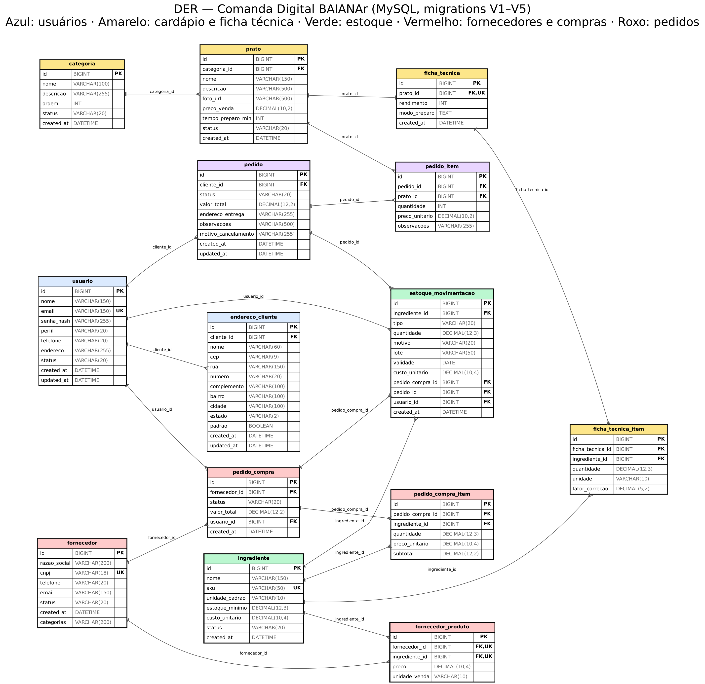

# Comanda Digital · Backend (BAIANAr)

Backend em **Spring Boot 3 / Java 17** do sistema de pedidos para dark kitchen **BAIANAr**,
conforme a Especificação de Requisitos de Software (SRS v3.2). Substitui o Firebase/Firestore
usado anteriormente no front por uma API REST própria com MySQL.

## Stack

- Java 17, Spring Boot 3.3.4, Maven
- Spring Data JPA + Hibernate, Flyway (migrations versionadas em `db/migration`)
- Spring Security + JWT (jjwt 0.12.6), BCrypt
- Bean Validation, SpringDoc OpenAPI (`/swagger-ui.html`)
- MySQL 8+

## Estrutura de pacotes

```
controller/        endpoints REST (público em controller/, admin em controller/admin/)
service/            toda a lógica de negócio (nunca no controller — RNF04)
repository/         interfaces JPA
entity/ + enums/    classes @Entity e enums de domínio
dto/request|response DTOs — nunca expomos @Entity diretamente (RNF05)
security/           JWT, UserDetails, filtros
config/             SecurityConfig, OpenApiConfig (CORS, Swagger)
exception/          @ControllerAdvice + exceções de negócio
```

## Rodando localmente

1. Suba um MySQL 8 local (ou `docker run -e MYSQL_ROOT_PASSWORD=root -p 3306:3306 mysql:8`).
2. Variáveis de ambiente (todas têm default para rodar local sem configurar nada, ver `application.yml`):

   | Variável | Default local | Descrição |
   |---|---|---|
   | `SPRING_DATASOURCE_URL` | `jdbc:mysql://localhost:3306/comanda_digital?createDatabaseIfNotExist=true` | URL do banco |
   | `SPRING_DATASOURCE_USERNAME` | `root` | usuário do banco |
   | `SPRING_DATASOURCE_PASSWORD` | `root` | senha do banco |
   | `JWT_SECRET` | chave de exemplo (troque em produção) | segredo HS256 |
   | `JWT_EXPIRATION_MS` | `28800000` (8h) | expiração do token |
   | `CORS_ALLOWED_ORIGINS` | `http://localhost:4200` | origens liberadas (separar por vírgula) |
   | `PORT` | `8080` | porta do servidor |

3. `mvn spring-boot:run` — o Flyway cria as tabelas e popula o seed automaticamente no primeiro start.
4. Swagger: http://localhost:8080/swagger-ui.html

Requisitos locais: **Java 17** e **Maven 3.9+**. Crie um `src/main/resources/application-local.yml` (já está no `.gitignore`,
nunca vai para o Git) com a senha do seu MySQL local e rode com `mvn spring-boot:run -Dspring-boot.run.profiles=local`.

## Credenciais de seed (Flyway `V2__seed_data.sql`)

Todas com senha **`senha123`**:

| Email | Perfil |
|---|---|
| `admin@email.com` | ADMIN |
| `gerente@email.com` | GERENTE |
| `cozinha@email.com` | COZINHEIRO |
| `cliente@email.com` | CLIENTE |

O seed cria o **cardápio completo do BAIANAr** (29 pratos, mesmos ids da tela do cliente), as fichas
técnicas de todos, **estoque inicial** de todos os ingredientes (sem isso a validação RN03 recusaria
qualquer pedido) e 2 pedidos de exemplo. Se você já subiu uma versão anterior do backend, apague o banco
antes (`DROP DATABASE comanda_digital;`) — o Flyway recria tudo no próximo start.

## Produção (deploy)

| Camada | Onde | URL / observação |
|---|---|---|
| Front-end (Angular) | Vercel | https://comanda-digital-baian-ar.vercel.app |
| Back-end (Spring Boot, `Dockerfile`) | Render — plano gratuito | https://baianar-api.onrender.com |
| Swagger | Render | https://baianar-api.onrender.com/swagger-ui.html |
| Banco de dados | TiDB Cloud Starter (compatível com MySQL 8) | acesso só pelo back-end, via variáveis de ambiente |

> ⏱️ **O back-end gratuito "dorme" após ~15 min sem requisições.** A primeira chamada depois disso leva até ~1 min.
> Antes de uma demonstração, abra o Swagger e aguarde carregar. Uma reinicialização completa leva ~2–3 min
> (a JVM roda com flags leves no `Dockerfile` por causa de 0,1 CPU / 512 MB).

**Variáveis de ambiente no Render** (nenhum segredo fica no repositório):

| Variável | Exemplo / descrição |
|---|---|
| `SPRING_DATASOURCE_URL` | `jdbc:mysql://<host>:4000/comanda_digital?sslMode=VERIFY_IDENTITY&createDatabaseIfNotExist=true&serverTimezone=UTC` |
| `SPRING_DATASOURCE_USERNAME` | usuário do TiDB |
| `SPRING_DATASOURCE_PASSWORD` | senha do TiDB (gerada no console, só aparece uma vez) |
| `JWT_SECRET` | string aleatória longa (use o botão *Generate* do Render) |
| `CORS_ALLOWED_ORIGINS` | URL do front, **sem barra final**; várias separadas por vírgula, sem espaços |

Passo a passo para refazer o deploy do zero:

1. **Banco:** console do TiDB Cloud → criar instância **Starter** (gratuita, sem cartão) → *Connect* → *General* → gerar a senha → criar o banco `comanda_digital`.
2. **Back-end:** Render → **New → Web Service** → repositório do back-end → *Language*: **Docker** → *Instance Type*: **Free** →
   cadastrar as variáveis acima → *Health Check Path*: `/swagger-ui.html`. O Flyway cria as tabelas e o seed no primeiro start.
3. **Front-end:** Vercel → importar o repositório do front (o `vercel.json` já define `dist/baianar/browser` e o rewrite SPA).
   O `environment.prod.ts` do front aponta para `https://baianar-api.onrender.com/api`.
4. Liberar a URL do front em `CORS_ALLOWED_ORIGINS` no Render (o serviço reinicia sozinho).

A porta é lida da variável `PORT`, que o Render injeta sozinho. O deploy acompanha a branch configurada em *Settings → Build & Deploy*.

## Modelo de dados (DER)



O diagrama acima reflete as migrations `V1` a `V5` (`src/main/resources/db/migration`).
Cores: azul = usuários · amarelo = cardápio e ficha técnica · verde = estoque · vermelho = fornecedores e compras · roxo = pedidos.

## Módulos do projeto (equipe de 5)

| Pessoa | Módulo |
|---|---|
| P1 | Pedidos e jornada do cliente (`PedidoClienteController`, checkout, histórico e status) |
| P2 | Cardápio e ficha técnica (RF-009 a RF-014) |
| P3 | Estoque (RF-027 a RF-033) |
| P4 | Fornecedores e compras (RF-021 a RF-026) |
| P5 | Autenticação/JWT/RBAC, usuários internos (RF-041), dashboard (RF-034 a RF-037), integração final e deploy |

## Limitações conhecidas (para não travar o Sprint Final)

- RF-019 pede filtro por "canal", mas a tabela `pedido` (seção 6 do SRS) não tem essa coluna —
  implementei filtro por `status` e período, que são os campos existentes no modelo de dados.
- RF-020 menciona "timeline de status"; como o modelo de dados não tem uma tabela de histórico de
  status, o detalhe do pedido expõe o status atual + `createdAt`/`updatedAt`. Se sobrar tempo, dá
  pra criar uma tabela `pedido_status_historico` e registrar cada transição.
- Pagamento é 100% simulado (SRS §1.2) — não existe campo de pagamento no pedido.
